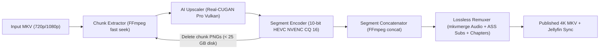

# AnimeUpscaler4K — Multi-GPU Real-CUGAN 4K Streaming Upscaler & Jellyfin Pipeline

An automated, crash-resumable **10-bit 4K UHD (2160p) AI Upscaling & Remuxing Pipeline** designed for classic anime series and full-length animated feature films (e.g., *Studio Ghibli*, *Neon Genesis Evangelion*).

Built around **Real-CUGAN (`ncnn-vulkan`)**, **10-bit HEVC NVENC (`p010le`)**, and **`mkvmerge`**, it upscales 720p/1080p sources to 4K while keeping temporary disk usage under **25 GB per GPU** (even on 2+ hour feature films) and losslessly preserving all original multi-channel audio tracks, ASS/PGS subtitles, font attachments, and chapters.

---

## Architecture & Pipeline Modes



The repository includes two orchestration strategies:
1. **`src/pipeline_chunked.py` (Recommended Default — Streaming Chunked Mode)**:
   - Best for **feature-length movies** (160,000–200,000+ frames) or systems with limited scratch SSD space.
   - Processes videos in configurable blocks (default: `14,385` frames $\approx 10\text{ minutes}$ at $23.976\text{ fps}$).
   - Encodes each block immediately into `.segments/<id>/seg_XXXX.mkv` and deletes the temporary PNGs before starting the next block.
   - If interrupted, resumes automatically from the last completed 10-minute segment.
2. **`src/batch_series_parallel.py` + `src/upscale_video.py` + `src/mkv_finalize.py` (Full-Episode QA Mode)**:
   - Best for **24-minute TV series episodes** where scratch space allows holding one episode's frames at a time.
   - Automatically detects $\le 720\text{p}$ episodes (applying a `3x` upscale) vs. $1080\text{p}$ episodes (`2x` upscale).
   - Runs `mkv_finalize.py` to verify SHA-256 stream payload hashes, audio/video packet interleaving, and FFmpeg seek accuracy before atomic publication.

---

## Reference Production Configuration

The reference configuration in [`config/pipeline.example.json`](config/pipeline.example.json) and [`.env.example`](.env.example) reflects the dual-GPU production setup used to upscale *Nausicaä del Valle del Viento (1984)*, *La Princesa Mononoke (1997)*, and *Neon Genesis Evangelion (S01E01–E26)*:

| Parameter | Reference Value | Purpose |
| :--- | :--- | :--- |
| **GPUs (`gpus` / `CUGAN_GPUS`)** | `[0, 1]` | **GPU 0**: NVIDIA RTX 3090 (24 GB VRAM)<br>**GPU 1**: NVIDIA RTX 4070 SUPER (12 GB VRAM) |
| **AI Model (`model` / `CUGAN_MODEL`)** | `models-pro` | Highest-fidelity Real-CUGAN Pro weights |
| **Scale (`scale` / `CUGAN_SCALE`)** | `2` (`3` for 720p) | $1920\times1080 \rightarrow 3840\times2160$ (4K UHD) |
| **Denoise (`noise` / `CUGAN_NOISE`)** | `-1` | Conservative denoise: preserves cel-animation line art and film texture without plastic smoothing |
| **Vulkan Threads (`threads` / `CUGAN_THREADS`)** | `2:2:2` | `load:proc:save` queue concurrency per GPU |
| **Chunk Size (`chunk_size` / `CHUNK_SIZE`)** | `14385` frames | $\approx 10\text{ mins}$ per segment at $23.976\text{ fps}$ ($\approx 20\text{–}25\text{ GB}$ peak scratch disk per worker) |
| **Video Encoder (`video_encoder`)** | `hevc_nvenc` | 10-bit HEVC (`main10`, `p010le`), `preset=p7` (slowest/highest quality), VBR `cq=16` |
| **Remuxer** | `mkvmerge` | Losslessly merges original Japanese/English audio, ASS subtitles, fonts, and chapters with localized track names |

---

## How to Personalize for Your Computer

Copy `.env.example` to `.env` and `config/pipeline.example.json` to `config/pipeline.json`, then adjust the following settings to match your hardware:

### 1. Single GPU vs. Multi-GPU (`gpus` / `CUGAN_GPUS`)
- **Single GPU (most desktops/laptops)**:
  - In `.env`: `CUGAN_GPUS=0`
  - In `config/pipeline.json`: `"gpus": [0]` (and set `"gpu": 0` or omit `"gpu"` on each item so all movies queue sequentially on GPU 0).
- **Dual / Multi-GPU server**:
  - In `.env`: `CUGAN_GPUS=0,1`
  - Run `vulkaninfo --summary` or `nvidia-smi` to verify your GPU indices. Each GPU worker processes a separate movie or episode in parallel.

### 2. GPU VRAM & Thread Tuning (`threads` / `CUGAN_THREADS`)
Real-CUGAN's `-j load:proc:save` controls how many frames are held in VRAM simultaneously:
- **12 GB – 24 GB+ VRAM** (RTX 3080 Ti, 3090, 4070 SUPER, 4080, 4090):
  - Keep `"threads": "2:2:2"` (or `"2:3:2"` on 24 GB cards).
- **8 GB VRAM** (RTX 3060 Ti, 3070, 4060 Ti):
  - Change to `"threads": "1:2:2"` or `"1:1:1"`.
- **4 GB – 6 GB VRAM**:
  - Change to `"threads": "1:1:1"` and set `"tile_size": "200"` in `settings` so frames are tiled instead of processed whole in VRAM.

### 3. Available Scratch SSD Space (`chunk_size` / `CHUNK_SIZE`)
Each 1080p input PNG ($\approx 2.5\text{ MB}$) + 4K upscaled PNG ($\approx 8\text{ MB}$) uses $\approx 10.5\text{ MB}$ of temporary space before the chunk is encoded and deleted. Choose `CHUNK_SIZE` based on your free SSD space:

| `CHUNK_SIZE` (Frames) | Video Duration (@ 23.976 fps) | Temp Disk per Active GPU | Recommended Free SSD Space |
| :--- | :--- | :--- | :--- |
| **`14385`** *(Reference)* | ~10.0 minutes | ~16 – 22 GB | **50 GB+** (or **80 GB+** for 2 GPUs) |
| **`7200`** | ~5.0 minutes | ~8 – 11 GB | **25 GB+** |
| **`3600`** | ~2.5 minutes | ~4 – 6 GB | **15 GB+** |
| **`1440`** | ~1.0 minute | ~1.6 – 2.5 GB | **10 GB+** |

### 4. Video Encoder Selection (`video_encoder` / `VIDEO_ENCODER`)
- **NVIDIA GPUs (Default)**:
  - `VIDEO_ENCODER=hevc_nvenc`, `VIDEO_PRESET=p7`, `VIDEO_CQ=16`
- **AMD / Intel GPUs on Linux (VAAPI)**:
  - `VIDEO_ENCODER=hevc_vaapi`, `VIDEO_CQ=18` (pass `/dev/dri:/dev/dri` into the container)
- **CPU Fallback (No hardware HEVC encoder / Apple Silicon / CPU server)**:
  - `VIDEO_ENCODER=libx265`, `VIDEO_PRESET=slow`, `VIDEO_CQ=18`
- **File Size vs. Quality (`cq` / `VIDEO_CQ`)**:
  - `16`: Near-lossless master for OLED TVs (~15 GB per 2-hour 4K movie, ~2.7 GB per 24-min episode).
  - `19–21`: Visually transparent at roughly **40–55% smaller** file size (~7–9 GB per movie).

### 5. Customizing Movies & Audio/Subtitle Track Labels (`config/pipeline.json`)
- **Auto-Discovery Mode**: If you leave `"items": []` empty in `config/pipeline.json` (or don't pass a config file), `pipeline_chunked.py` automatically discovers every `.mkv` file in `/input`, probes its resolution/frame count via `ffprobe`, upscales it to 4K, and remuxes all original audio/subtitle/chapter streams unchanged into `/output/<filename> [2160p 4K HEVC].mkv`.
- **Explicit Track Renaming & Language Fixes**: Many anime releases mistag subtitle language codes (e.g., tagging English ASS subtitles as `jpn`). Use `track_overrides` in `config/pipeline.json` to inspect track IDs with `mkvmerge -i input.mkv` and assign clean language codes and display titles:
  ```json
  "track_overrides": [
    { "track_id": 1, "language": "jpn", "name": "Japonés (Audio Original)" },
    { "track_id": 2, "language": "eng", "name": "Inglés (Doblaje)" },
    { "track_id": 3, "language": "eng", "name": "Subtítulos Completos" }
  ]
  ```

---

## Quickstart with Docker (Recommended)

### Prerequisites
1. **Docker** & **Docker Compose v2**
2. **NVIDIA Driver** + **[NVIDIA Container Toolkit](https://docs.nvidia.com/datacenter/cloud-native/container-toolkit/latest/install-guide.html)** installed on the host.

### Step 1: Configure `.env` and `config/pipeline.json`
```bash
cp .env.example .env
cp config/pipeline.example.json config/pipeline.json
mkdir -p data/input data/output data/workspace
```
Place your source `.mkv` files in `data/input/` (or change `HOST_INPUT_DIR` and `HOST_OUTPUT_DIR` in `.env` to point directly to your media library folders).

### Step 2: Build & Run the Container
```bash
docker compose up --build -d
docker compose logs -f
```

---

## Running on Bare Metal (Ubuntu / Debian)

### Step 1: Install Dependencies & Real-CUGAN
```bash
sudo apt-get update && sudo apt-get install -y ffmpeg mkvtoolnix python3 libvulkan1 mesa-vulkan-drivers wget unzip

wget https://github.com/nihui/realcugan-ncnn-vulkan/releases/download/20220728/realcugan-ncnn-vulkan-20220728-ubuntu.zip
unzip realcugan-ncnn-vulkan-20220728-ubuntu.zip
chmod +x realcugan-ncnn-vulkan-20220728-ubuntu/realcugan-ncnn-vulkan
```

### Step 2: Run the Chunked Movie Pipeline
```bash
python3 src/pipeline_chunked.py --config config/pipeline.json
```

### Step 3: Run the Series Episode Batch Pipeline
```bash
python3 src/batch_series_parallel.py \
  --input-dir /path/to/series_input \
  --output-dir "/path/to/Neon Genesis Evangelion (4K)" \
  --series-title "Neon Genesis Evangelion" \
  --season 1 \
  --gpus "0,1"
```

---

## Jellyfin Integration & Metadata Manager

To automatically refresh Jellyfin when movies finish upscaling:
1. Generate an API key in **Jellyfin Dashboard $\rightarrow$ Administration $\rightarrow$ API Keys**.
2. Set `JELLYFIN_URL` and `JELLYFIN_API_KEY` in `.env`.

You can also use `src/jellyfin_sync.py` standalone to trigger scans or push & lock rich localized metadata (Spanish/English titles, synopses, cast/crew, studios, ratings, IMDb/TMDB IDs, and 4K Primary/Thumb/Backdrop images):
```bash
python3 src/jellyfin_sync.py \
  --url http://127.0.0.1:8096 \
  --api-key YOUR_JELLYFIN_API_KEY \
  --refresh-only
```
